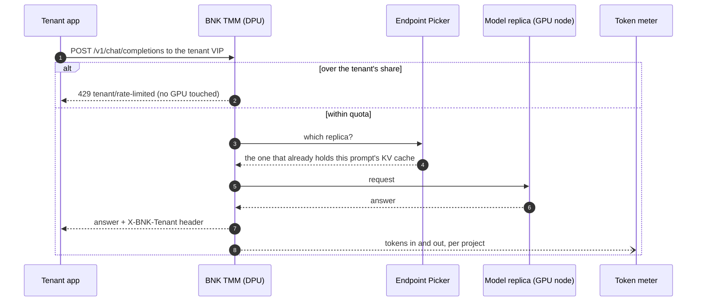
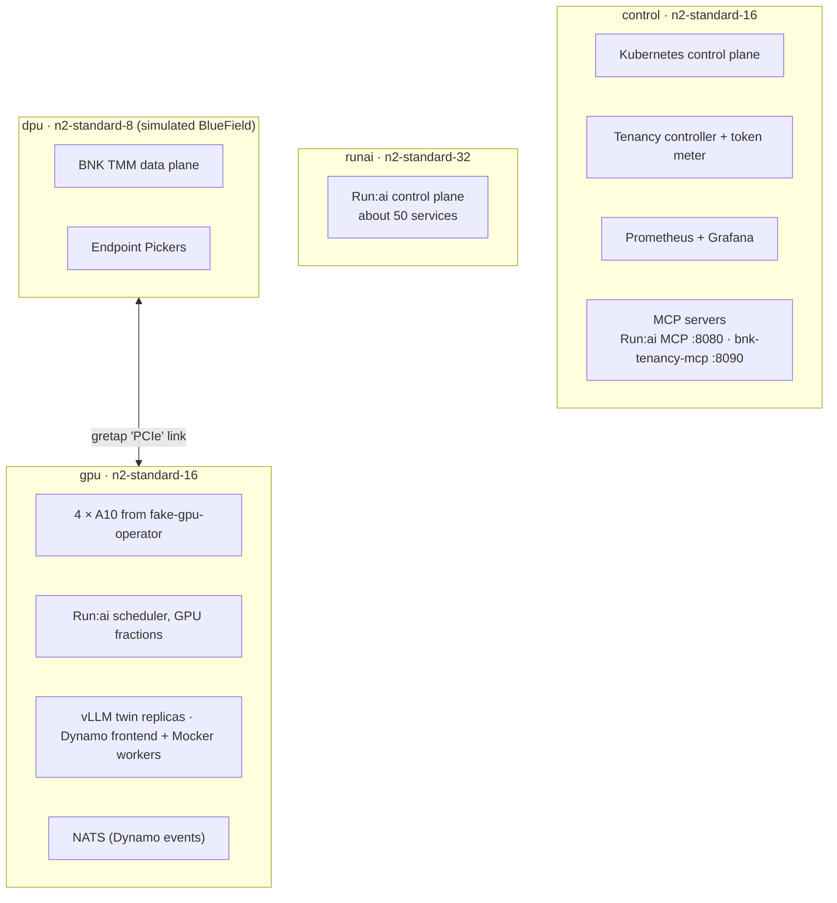
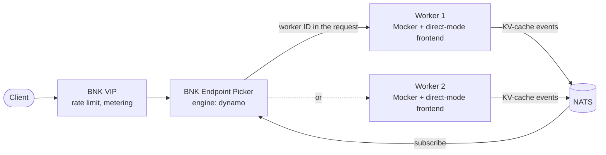
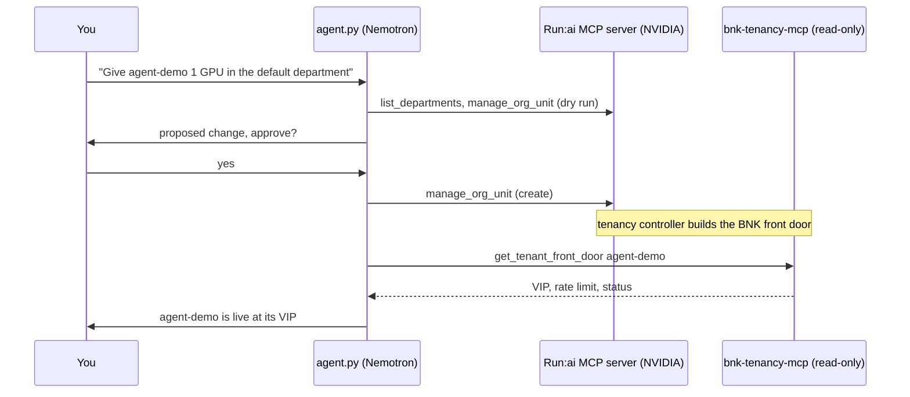

# BNK 2.4 with open-source NVIDIA Run:ai

**Define a tenant once in Run:ai. F5 BIG-IP Next for Kubernetes (BNK) builds its front door, its rate
limit and its token meter on its own.**

This repo is the source of a hands-on Instruqt lab. It runs a real four-node Kubernetes cluster with
real BNK 2.4 and the open-source NVIDIA Run:ai platform, shared by several AI tenants. The GPUs are
simulated, everything that decides who gets in, how fast, and on which worker is real.


## The idea in one picture

Run:ai owns the GPU. BNK owns the request. A small open-source controller connects the two, so a
platform team has one place to describe a tenant.


What the controller builds from one Run:ai project:

| From Run:ai | Becomes in BNK |
|---|---|
| Project `tenant-a` | Its own Gateway and VIP, an HTTPRoute, an InferencePool and an Endpoint Picker |
| GPU quota (`gpuDeserved`) | A rate limit at the edge: `20 req/s × max(GPU quota, 0.25)` |
| Queue priority | The inference objective's criticality (100 and above is Critical) |
| Namespace marked as running Dynamo | The Endpoint Picker in Dynamo mode, listening to Dynamo's KV-cache events |
| Project deleted | Every BNK object for it removed |

## What a request goes through



The 429 happens at the BNK edge, before the GPU. A noisy tenant is stopped there, and its neighbour
on the same GPU keeps its latency.

## The cluster

Four VMs, one Kubernetes cluster. The DPU is a separate node joined to the GPU server by a tunnel,
standing in for a BlueField DPU in the same server.



The interactive version, with animated flows for each challenge, is
[`platform/topology/topology.html`](platform/topology/topology.html). Open it in a browser.

## The challenges

| # | Challenge | What you see |
|---|---|---|
| 1 | [Meet the AI factory](instruqt/bnk-runai/01-meet-the-factory/assignment.md) | The cluster, Run:ai, BNK, and what is real versus simulated |
| 2 | [Define a tenant once](instruqt/bnk-runai/02-tenant-defined-once/assignment.md) | Create a Run:ai project, watch its BNK front door appear |
| 3 | [Isolation before the GPU](instruqt/bnk-runai/03-isolation-before-the-gpu/assignment.md) | One tenant overloads, gets 429 at the edge, the other keeps its latency |
| 4 | [Tokens per project](instruqt/bnk-runai/04-tokens-per-project/assignment.md) | Tokens counted at the edge, per project and department |
| 5 | [NVIDIA Dynamo, with BNK picking the worker](instruqt/bnk-runai/05-dynamo-on-runai/assignment.md) | BNK reads Dynamo's KV-cache events and routes each prompt to the worker that holds it |
| 6 | [What you built, and what's next](instruqt/bnk-runai/06-debrief/assignment.md) | An AI agent creates a tenant over MCP, a human approves |

<table>
<tr>
<td></td>
<td></td>
</tr>
<tr>
<td></td>
<td></td>
</tr>
</table>

## Dynamo, with BNK picking the worker

NVIDIA Dynamo runs as one more Run:ai project. Its workers publish every KV-cache block they store or
evict on NATS. BNK's Endpoint Picker, in Dynamo mode, subscribes to those events and sends each request
straight to the worker that already holds the prompt. Dynamo's own router is not in the path.



In the lab, two different long prompts each stay on one worker six times out of six. A
NetworkPolicy lets only Dynamo tenants reach NATS, so no other pod can read or fake those events.
Details in [`docs/dynamo-research.md`](docs/dynamo-research.md).

## An AI agent that runs it

Challenge 6 hands the same job to an agent. It talks to two MCP servers and any OpenAI-compatible
LLM (the lab uses NVIDIA Nemotron on build.nvidia.com).



Every write needs a person to approve it. The approval gate fails closed: any tool not on the
read-only list is treated as a write. See [`platform/mcp/agent.py`](platform/mcp/agent.py) and
[`docs/mcp.md`](docs/mcp.md).

## Real and simulated

| Real | Simulated |
|---|---|
| BNK 2.4 data and control plane, rate limits, Endpoint Picker, metering path | The GPUs (fake-gpu-operator, 4 × A10) |
| Run:ai control plane, projects, quotas, scheduler, GPU fractions | Model servers: vLLM twin and Dynamo Mocker (real tokenizer, no weights) |
| Kubernetes, the tenancy controller, Prometheus and Grafana | The BlueField DPU (a separate node with a tunnel) |
| Dynamo operator, frontend and its KV-cache events over NATS | |
| Both MCP servers and the LLM the agent talks to | |

## What is in this repo

| Path | What it is |
|---|---|
| [`controller/`](controller) | The tenancy controller, token meter and `bnk-tenancy-mcp`, in Go (`cmd/manager`, `cmd/meter`, `cmd/mcp`) |
| [`charts/bnk-runai-tenancy`](charts/bnk-runai-tenancy) | Helm chart for the controller and meter |
| [`platform/`](platform) | Install scripts: cluster and BNK, Run:ai, fake GPUs, models, Dynamo, MCP, observability, topology page |
| [`labctl/`](labctl) | The learner CLI: `labctl tenant create`, `labctl load overload`, `labctl chat` and more |
| [`loadgen/`](loadgen) | Load generator for steady, overload and prefix-heavy traffic |
| [`instruqt/bnk-runai/`](instruqt/bnk-runai) | The Instruqt track: challenges, setup scripts, slides |
| [`platform/versions.env`](platform/versions.env) | Every pinned version and image digest |
| [`docs/`](docs) | Design notes: Dynamo, MCP, verified BNK resource names, build and deploy flow |

## Try the CLI

Inside the lab, on the control node:

```bash
labctl tenant create tenant-a --gpu 1 --priority High
labctl model deploy tenant-a
labctl chat tenant-a "Hello from the BNK front door"
labctl load overload --tenant tenant-b --seconds 30
labctl tenant show tenant-a
```

## Versions

BNK 2.4.0 on Kubernetes 1.30, open-source Run:ai from
[dsx-ai-factory/run-ai](https://github.com/dsx-ai-factory/run-ai), NVIDIA Dynamo operator 1.5.1,
fake-gpu-operator 0.2.1, kube-prometheus-stack 91.9.0, NVIDIA Run:ai MCP server 2.26.50. The full list,
with commits and image digests, is in [`platform/versions.env`](platform/versions.env).

## Further reading

- [NVIDIA and F5 on BlueField-3](https://blogs.nvidia.com/blog/nvidia-f5/)
- [Open-source NVIDIA Run:ai](https://github.com/dsx-ai-factory/run-ai)
- [NVIDIA Dynamo](https://github.com/ai-dynamo/dynamo)

## License

Apache 2.0, see [LICENSE](LICENSE).
