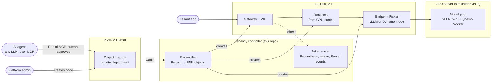
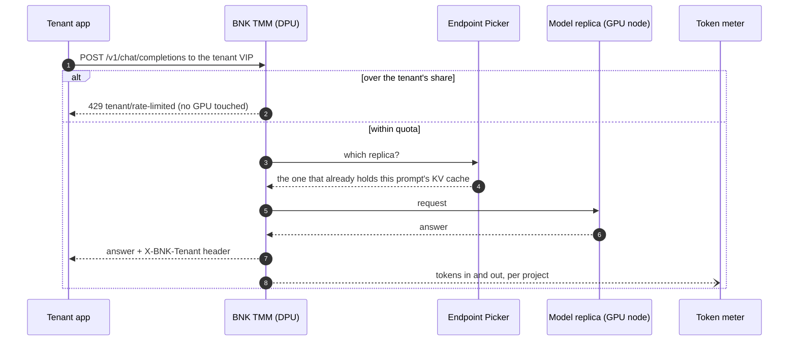
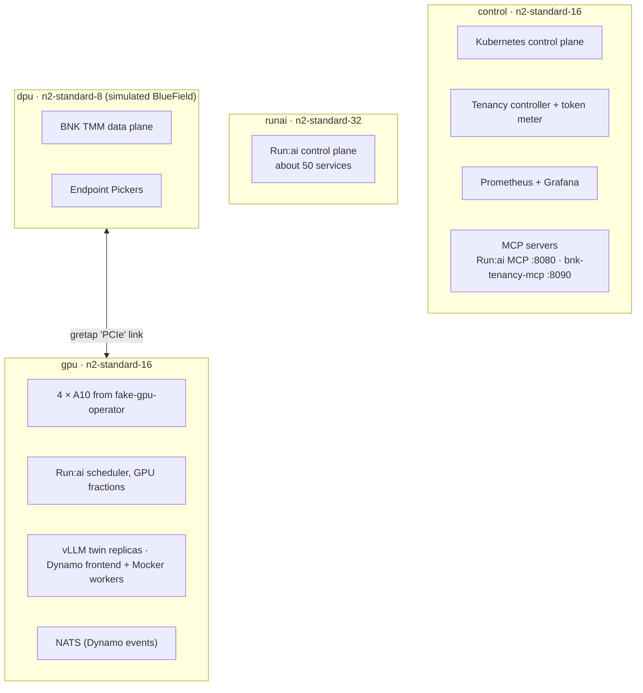
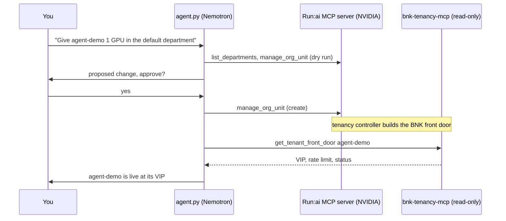

# BNK 2.4 with open-source NVIDIA Run:ai

**You define a tenant in Run:ai. F5 BIG-IP Next for Kubernetes (BNK) builds its front door, rate
limit and token meter for you.**

This is the source of an Instruqt lab I built for GTC Berlin. You get four VMs and one Kubernetes
cluster running BNK 2.4 and the open-source NVIDIA Run:ai platform, with a few AI tenants sharing the
same GPUs. The GPUs are fake. The rest is real software: the parts that decide whether a request gets
in, how fast, and which worker serves it.

A new Run:ai project has a working BNK front door about 30 seconds later. Nobody opens a BNK config.


## The idea in one picture

Run:ai owns the GPU. BNK owns the request. Today a platform team has to describe every tenant twice,
once on each side, and keep the two in sync by hand. The tenancy controller in this repo watches Run:ai
and writes the BNK side, so there is only one place to get it right.



What the controller builds from one Run:ai project:

| From Run:ai | Becomes in BNK |
|---|---|
| Project `tenant-a` | Its own Gateway and VIP, an HTTPRoute, an InferencePool and an Endpoint Picker |
| GPU quota (`gpuDeserved`) | A rate limit at the edge: `20 req/s × max(GPU quota, 0.25)` |
| Queue priority | The inference objective's criticality (100 and above is Critical) |
| Namespace marked as running Dynamo | The Endpoint Picker in Dynamo mode, listening to Dynamo's KV-cache events |
| Project deleted | Every BNK object for it removed |

## What a request goes through



The 429 comes from BNK, so an over-quota request never reaches a GPU. In challenge 3 BNK refused
74% of `tenant-b`'s excess traffic while `tenant-a`, on the same GPU at the same moment, had nothing
refused.

## The cluster

On real hardware, BNK's data plane (TMM) runs on a BlueField-3 DPU inside the GPU server. Here the DPU
is its own VM, joined to the GPU node by a GRE tunnel that plays the part of the PCIe link.



There's an interactive version with an animated flow for each challenge:
[`platform/topology/topology.html`](platform/topology/topology.html). It's a single file, so you can
open it straight in a browser.

## The challenges

| # | Challenge | What you see |
|---|---|---|
| 1 | [Meet the AI factory](instruqt/bnk-runai/01-meet-the-factory/assignment.md) | The cluster, Run:ai, BNK, and what is real versus simulated |
| 2 | [Define a tenant once](instruqt/bnk-runai/02-tenant-defined-once/assignment.md) | Create a Run:ai project, watch its BNK front door appear |
| 3 | [Isolation before the GPU](instruqt/bnk-runai/03-isolation-before-the-gpu/assignment.md) | One tenant overloads, gets 429 at the edge, the other keeps its latency |
| 4 | [Tokens per project](instruqt/bnk-runai/04-tokens-per-project/assignment.md) | Tokens counted at the edge, per project and department |
| 5 | [NVIDIA Dynamo, with BNK picking the worker](instruqt/bnk-runai/05-dynamo-on-runai/assignment.md) | BNK reads Dynamo's KV-cache events and routes each prompt to the worker that holds it |
| 6 | [What you built, and what's next](instruqt/bnk-runai/06-debrief/assignment.md) | An AI agent creates a tenant over MCP, a human approves |

<table>
<tr>
<td></td>
<td></td>
</tr>
<tr>
<td></td>
<td></td>
</tr>
</table>

## Dynamo, with BNK picking the worker

This is the part people ask about most. NVIDIA Dynamo runs as just another Run:ai project. Each
worker announces on NATS every KV-cache block it stores or evicts. BNK 2.4's Endpoint Picker has a
Dynamo mode that listens to those announcements, works out which worker already holds the prompt, and
sends the request there. Dynamo's own router isn't used.


In the lab you send two long prompts six times each. Each one lands on the same worker all six
times. NATS has no authentication, so a NetworkPolicy keeps everyone but Dynamo tenants off it. Without
that, any pod could forge cache events and steer the picker. The notes are in
[`docs/dynamo-research.md`](docs/dynamo-research.md).

## An AI agent that runs it

In challenge 6 you ask an agent for a tenant in plain English. It's about 250 lines of plain Python with no
framework. It talks to NVIDIA's Run:ai MCP server, to our read-only `bnk-tenancy-mcp`, and to any
OpenAI-compatible model. The lab uses Nemotron on build.nvidia.com.



A person approves every change. The gate fails closed: a tool counts as a write unless it's on a
short read-only list, so a new or renamed tool can't slip through. Code in
[`platform/mcp/agent.py`](platform/mcp/agent.py), design notes in [`docs/mcp.md`](docs/mcp.md).

## Real and simulated

| Real | Simulated |
|---|---|
| BNK 2.4 data and control plane, rate limits, Endpoint Picker, metering path | The GPUs (fake-gpu-operator, 4 × A10) |
| Run:ai control plane, projects, quotas, scheduler, GPU fractions | Model servers: vLLM twin and Dynamo Mocker (real tokenizer, no weights) |
| Kubernetes, the tenancy controller, Prometheus and Grafana | The BlueField DPU (a separate node with a tunnel) |
| Dynamo operator, frontend and its KV-cache events over NATS | |
| Both MCP servers and the LLM the agent talks to | |

## What is in this repo

| Path | What it is |
|---|---|
| [`controller/`](controller) | The tenancy controller, token meter and `bnk-tenancy-mcp`, in Go (`cmd/manager`, `cmd/meter`, `cmd/mcp`) |
| [`charts/bnk-runai-tenancy`](charts/bnk-runai-tenancy) | Helm chart for the controller and meter |
| [`platform/`](platform) | Install scripts: cluster and BNK, Run:ai, fake GPUs, models, Dynamo, MCP, observability, topology page |
| [`labctl/`](labctl) | The learner CLI: `labctl tenant create`, `labctl load overload`, `labctl chat` and more |
| [`loadgen/`](loadgen) | Load generator for steady, overload and prefix-heavy traffic |
| [`instruqt/bnk-runai/`](instruqt/bnk-runai) | The Instruqt track: challenges, setup scripts, slides |
| [`platform/versions.env`](platform/versions.env) | Every pinned version and image digest |
| [`docs/`](docs) | Design notes: Dynamo, MCP, verified BNK resource names, build and deploy flow |

## Try the CLI

On the control node inside the lab:

```bash
labctl tenant create tenant-a --gpu 1 --priority High
labctl model deploy tenant-a
labctl chat tenant-a "Hello from the BNK front door"
labctl load overload --tenant tenant-b --seconds 30
labctl tenant show tenant-a
```

## Versions

BNK 2.4.0 on Kubernetes 1.30, open-source Run:ai from
[dsx-ai-factory/run-ai](https://github.com/dsx-ai-factory/run-ai), NVIDIA Dynamo operator 1.5.1,
fake-gpu-operator 0.2.1, kube-prometheus-stack 91.9.0, NVIDIA Run:ai MCP server 2.26.50. The full list,
with commits and image digests, is in [`platform/versions.env`](platform/versions.env).

## Further reading

- [NVIDIA and F5 on BlueField-3](https://blogs.nvidia.com/blog/nvidia-f5/)
- [Open-source NVIDIA Run:ai](https://github.com/dsx-ai-factory/run-ai)
- [NVIDIA Dynamo](https://github.com/ai-dynamo/dynamo)

## License

Apache 2.0, see [LICENSE](LICENSE).
