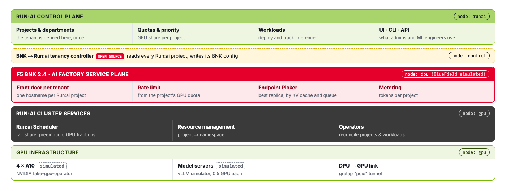

Here is the stack you are about to explore. NVIDIA's Run:ai layers are in green and grey, the F5
layer in red, and the controller that joins them in yellow. Each layer shows the node it runs on.



Your tabs:

| Tab | What it is |
|---|---|
| **Terminal** | `kubectl` and `labctl` on the control node |
| **Run:ai UI** | the open-source Run:ai console, in a browser inside the lab |
| **Grafana** | "One tenant, two planes": Run:ai's GPU view and BNK's request view side by side |
| **Lab code** | the controller, the installers and these challenges |
| **GPU node / DPU node** | shells on those machines, if you want to look around |

# Step 1: Four real nodes

```bash,run
kubectl get nodes -L app,run.ai/simulated-gpu-node-pool
```

- `control` runs the Kubernetes control plane, the tenancy controller and Grafana.
- `dpu` stands in for a BlueField DPU. BNK's data plane, TMM, runs here.
- `gpu` carries four simulated NVIDIA A10s. Model servers run here.
- `runai` runs the Run:ai control plane: about 30 services, Keycloak, Postgres and NATS.

The GPUs come from NVIDIA's own GPU simulator, so the scheduler sees real GPU resources:

```bash,run
kubectl get node gpu -o jsonpath='{.status.allocatable.nvidia\.com/gpu} GPUs on node gpu{"\n"}'
```

# Step 2: BNK 2.4

TMM runs on the dpu node; the BNK controller turns Kubernetes objects into TMM config:

```bash,run
kubectl get pods -n f5-bnk -o wide | grep -E 'NAME|tmm|cne-controller'
kubectl get gatewayclass
```

`f5-gateway-class` is how a Kubernetes Gateway asks for BNK. Every tenant front door in this lab is a
standard Gateway API object served by BNK.

# Step 3: Open-source Run:ai

The control plane (UI, API, identity, database) and the cluster side (scheduler, operators, agent):

```bash,run
kubectl get pods -n runai-backend --no-headers | awk '{print $3}' | sort | uniq -c
kubectl get pods -n runai | grep -E 'NAME|scheduler|operator|agent|project'
```

Run:ai's scheduler is `runai-scheduler`; workloads join a project's queue with the label `runai/queue`.

Now open the **Run:ai UI** tab and sign in:

| User | Password |
|---|---|
| `admin@acme.lab` | `Lab-Admin-1!` |

Look at **Resources → Clusters** (one cluster, `acme-ai-factory`) and **Resources → Nodes** (the gpu
node with 4 GPUs). There are no projects yet. You create them in the next challenge, in Run:ai, and BNK
follows on its own.

# Step 4: The glue

The tenancy controller is the only new piece. It watches Run:ai projects and nothing else:

```bash,run
kubectl -n bnk-runai-tenancy get pods
kubectl -n bnk-runai-tenancy logs deploy/bnk-runai-tenancy --tail=5
```

Open **Grafana**. The board is empty for now; each tenant you create gets its own row.

> **What is real here:** BNK 2.4, open-source Run:ai and its scheduler, Kubernetes and every network
> path. **What is simulated:** the GPUs (NVIDIA fake-gpu-operator), the model servers (a vLLM
> simulator), and the DPU (a VM with a tunnel to the GPU node; the path is real, the offload is not).

Click **Check** when you've looked around.
