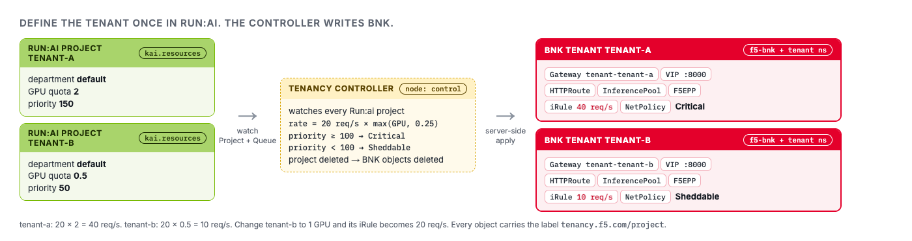

# Define a tenant once

In Run:ai, a **project** is the tenant. It owns a GPU quota, a priority and a namespace.

In this challenge you create two projects and **never touch BNK**. The tenancy controller reads each
project and writes the BNK objects that serve it.



> **Why it matters:** the platform owner keeps defining tenants in the tool they already use, and the
> network follows.

---

## Step 1 · Create a tenant in the Run:ai UI

Start the way a Run:ai admin would. Open the **Run:ai UI** tab and sign in as
`admin@acme.lab` / `Lab-Admin-1!`.

1. Go to **Organization → Projects → NEW PROJECT**.
2. Department **`default`**, name **`tenant-a`**.
   Leave the namespace empty: Run:ai creates `runai-tenant-a` itself.
3. **GPU quota:** `2` GPUs on the `default` node pool.
4. Click **SAVE & CONTINUE** through the remaining steps, then **CREATE PROJECT**.

Now watch BNK follow, without touching BNK:

```bash,run
until kubectl get projects.kai.resources tenant-a -o jsonpath='{.status.phase}' 2>/dev/null | grep -q Ready; do sleep 3; done
kubectl get projects.kai.resources tenant-a -o jsonpath='{.status.phase} {.status.namespace}{"\n"}'
sleep 20; kubectl get gateways -n f5-bnk -o wide
```

**You should see:** `Ready runai-tenant-a`, then a `tenant-a` Gateway with its own address and
`PROGRAMMED True`, about half a minute after you clicked create.

---

## Step 2 · A second tenant, from the terminal

Give `tenant-a` a high priority and create `tenant-b` with half a GPU:

```bash,run
labctl tenant create tenant-a --gpu 2 --priority 150
labctl tenant create tenant-b --gpu 0.5 --priority 50
```

`labctl` calls the **Run:ai REST API**, the same API the UI and CLI use.

> Run:ai does not let anyone write projects with `kubectl`. Its admission webhook allows only Run:ai's
> own services, so the API is the one front door for tenants.

Here is the call `labctl` made, so nothing is hidden:

```bash,run
TOK=$(curl -s --cacert /etc/runai/ca.crt https://runai.lab/api/v1/token -H 'Content-Type: application/json' \
  -d '{"grantType":"password","username":"admin@acme.lab","password":"Lab-Admin-1!"}' | jq -r .accessToken)
curl -s --cacert /etc/runai/ca.crt https://runai.lab/api/v1/org-unit/projects -H "Authorization: Bearer $TOK" \
  | jq '.projects[] | {id, name, parentId, gpu: .resources[0].gpu.deserved}'
```

Run:ai then writes the cluster object, an ordinary `kai.resources/v1alpha1` Project. The tenancy
controller reads that object. It never writes to it.

```bash,run
kubectl get projects.kai.resources
kubectl get projects.kai.resources tenant-a -o yaml | sed -n '/^spec:/,$p'
```

Four fields matter:

| Field | Meaning |
|---|---|
| `spec.parent` | the department |
| `spec.queues[].resources.gpu.deserved` | the GPU quota |
| `spec.queues[].priority` | the priority rank |
| `status.namespace` | where the project's workloads run. The controller reads it, never guesses it |

Back in the **Run:ai UI** tab, **Organization → Projects** now lists both tenants with their quotas.
Nothing about BNK appears there, and nothing needs to.

---

## Step 3 · One model per tenant, on the same GPU

Each tenant gets one model server asking for half a GPU:

```bash,run
labctl model deploy tenant-a --fraction 0.5
labctl model deploy tenant-b --fraction 0.5
```

Where did the Run:ai scheduler put them?

```bash,run
for t in tenant-a tenant-b; do
  NS=$(kubectl get projects.kai.resources $t -o jsonpath='{.status.namespace}')
  kubectl get pods -n "$NS" -l app.kubernetes.io/part-of=model-server \
    -o custom-columns='POD:.metadata.name,NODE:.spec.nodeName,SCHEDULER:.spec.schedulerName,GPU-FRACTION:.metadata.annotations.gpu-fraction,QUEUE:.metadata.labels.runai/queue'
done
```

**You should see:** both pods on node `gpu`, scheduler `runai-scheduler`, fraction `0.5`.

Two tenants now share one physical GPU. Good for utilisation. But it also means whoever sends more
requests gets more of that GPU, unless something stops them first. That's the next challenge.

> The GPUs come from NVIDIA's fake-gpu-operator and the models are vLLM simulators. Scheduling and
> fractions are real Run:ai behaviour. GPU memory isolation is something this lab can't show.

---

## Step 4 · The BNK tenants that appeared

You created nothing in BNK. Ask the controller what it built:

```bash,run
labctl tenant show tenant-a
```

The same objects with plain `kubectl`. Everything carries the label `tenancy.f5.com/project`:

```bash,run
kubectl get gateway -n f5-bnk -l tenancy.f5.com/project -o wide
NS=$(kubectl get projects.kai.resources tenant-a -o jsonpath='{.status.namespace}')
kubectl get httproute,inferencepools.inference.networking.k8s.io,f5-epps -n "$NS"
kubectl get f5-big-cne-irules,netpolicies -n f5-bnk -l tenancy.f5.com/project=tenant-a
```

Per tenant:

| Object | Where | Job |
|---|---|---|
| **Gateway** | `f5-bnk` | the tenant's front door, with its own address |
| **HTTPRoute** | tenant namespace | sends `/v1` traffic to the model pool |
| **InferencePool** | tenant namespace | the tenant's model servers |
| **F5EPP** | tenant namespace | BNK's Endpoint Picker for that pool |
| **F5BigCneIrule** + **NetPolicy** | `f5-bnk` | the rate limit, enforced in TMM |

The rate limit is **20 requests per second per GPU of quota**:

```bash,run
for t in tenant-a tenant-b; do
  echo -n "$t limit: "
  kubectl get f5-big-cne-irules -n f5-bnk $t-limit -o jsonpath='{.spec.iRule}' | grep -o 'rl_n > [0-9]*'
done
```

**You should see:** `tenant-a` 40 (2 GPU), `tenant-b` 10 (0.5 GPU).

The controller also turns the Run:ai rank into a priority class (Medium 150 → Critical, Low 50 →
Sheddable) and posts it as an event on the Run:ai project:

```bash,run
kubectl get events -A --field-selector involvedObject.kind=Project,reason=BNKTenantReady \
  -o custom-columns='PROJECT:.involvedObject.name,MESSAGE:.message'
```

> In this lab BNK enforces the rate limit. The priority class is recorded, not yet enforced.

**In Grafana**, the table **Tenants: Run:ai project → BNK tenant** now has a row for each project. The
GPU quota comes from Run:ai and the tenant state from BNK, side by side.

---

## Step 5 · Chat through each tenant's front door

```bash,run
labctl vip tenant-a
labctl chat tenant-a "Say hello in five words."
labctl chat tenant-b "Say hello in five words."
```

Every answer is tagged with the Run:ai project it was served for. Check the header on a raw request.
The address comes straight from the Gateway's status:

```bash,run
VIP=$(kubectl get gateway -n f5-bnk tenant-b -o jsonpath='{.status.addresses[0].value}')
curl -si http://$VIP:8000/v1/models | grep -i -E '^HTTP|x-bnk-tenant'
```

**You should see:** `HTTP/1.1 200 OK` and `X-BNK-Tenant: tenant-b`.

---

## Step 6 · Change the quota in Run:ai, watch the limit follow

Give `tenant-b` a full GPU. You could do the same in the **Run:ai UI** (edit `tenant-b`, GPU quota 1,
save). Either way, Run:ai is the only place you change it:

```bash,run
labctl tenant create tenant-b --gpu 1 --priority 50
sleep 15
kubectl get f5-big-cne-irules -n f5-bnk tenant-b-limit -o jsonpath='{.spec.iRule}' | grep -o 'rl_n > [0-9]*'
```

**You should see:** `rl_n > 20`. Put it back to half a GPU for the next challenge:

```bash,run
labctl tenant create tenant-b --gpu 0.5 --priority 50
```

**In Grafana**, the panel **GPU quota by department** shows the quota step up and back down again.

---

## Step 7 · Delete a tenant, BNK forgets it

Create a throwaway tenant, check BNK built it, then delete it:

```bash,run
labctl tenant create tenant-c --gpu 0.25 --priority 10
sleep 10
kubectl get gateway,f5-big-cne-irules,netpolicies -n f5-bnk -l tenancy.f5.com/project=tenant-c
labctl tenant delete tenant-c
sleep 15
kubectl get gateway,f5-big-cne-irules,netpolicies -n f5-bnk -l tenancy.f5.com/project=tenant-c
```

**You should see:** three objects the first time, `No resources found` the second time.

When the Run:ai project went, the controller removed every BNK object labelled with it. The address
it used is held back for 15 minutes so a new tenant can't pick it up straight away. And if a project
disappears while the controller is down, it notices on start-up and cleans up then.

So no front door is ever left serving a tenant that no longer exists. Here is the controller's own log:

```bash,run
kubectl -n bnk-runai-tenancy logs deploy/bnk-runai-tenancy --tail=20
```

Click **Check** when both tenants answer.
