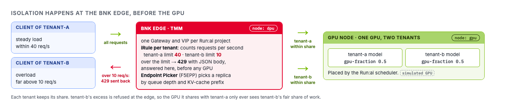

`tenant-a` and `tenant-b` share one GPU, half each. A GPU has no idea which tenant a request came
from: it serves whatever arrives. If `tenant-b` sends ten times its fair load, `tenant-a`'s requests
queue behind it.

Run:ai already decides how much GPU each project **deserves**. BNK enforces that share on the
request path, so each tenant keeps its share and the excess is refused at the edge.



# Step 1: Start tenant-a's normal traffic

In **Terminal 2**, run steady load against `tenant-a` for three minutes. Leave it running:

```bash,run
labctl load steady --tenant tenant-a --seconds 180
```

Watch its success rate and p95 latency. This is the baseline.

# Step 2: Overload tenant-b

Back in **Terminal**, send `tenant-b` far more than its 10 requests per second:

```bash,run
labctl load overload --tenant tenant-b --seconds 60
```

Most of tenant-b's requests come back as 429. Look at one refusal yourself:

```bash,run
VIP=$(kubectl get gateway -n f5-bnk tenant-b -o jsonpath='{.status.addresses[0].value}')
for i in $(seq 1 30); do curl -s -o /dev/null http://$VIP:8000/v1/models & done; wait
curl -si http://$VIP:8000/v1/models | sed -n '1p;/x-bnk-tenant/Ip;/retry-after/Ip;$p'
```

The body is JSON with code `tenant/rate-limited` and names the Run:ai project. The 429 was produced
by the tenant's iRule in TMM, BNK's data plane. The request never reached a model server, so it used
no GPU time. Here is the rule that answered:

```bash,run
kubectl get f5-big-cne-irules -n f5-bnk tenant-b-limit -o jsonpath='{.spec.iRule}'
```

Now look at **Terminal 2**. `tenant-a`'s p95 stayed where it was. That is the result an AI factory
operator wants: a tenant that exceeds its quota slows only itself.

Open the **Grafana** tab to see the same thing per project: requests by response code, with 429s for
`tenant-b` only.

> The model servers are vLLM simulators whose latency grows with load, so the effect on a shared GPU
> is modelled, not measured on real silicon. The 429s and where they happen are real BNK behaviour.

# Step 3: The Endpoint Picker inside a tenant

Rate limits decide how much traffic a tenant gets. Inside the tenant, BNK's Endpoint Picker decides
which replica serves each request. Give `tenant-a` two replicas:

```bash,run
labctl model deploy tenant-a --replicas 2 --fraction 0.5
NS=$(kubectl get projects.kai.resources tenant-a -o jsonpath='{.status.namespace}')
kubectl get pods -n "$NS" -o wide -l app.kubernetes.io/part-of=model-server
```

The picker is an `F5EPP` object, created by the controller for each tenant. It scores replicas by
queue depth and by KV-cache prefix matches:

```bash,run
kubectl get f5-epps -n "$NS" model-pool-epp -o jsonpath='{.spec.eppConfig}' | jq .
kubectl get inferencepools.inference.networking.k8s.io -n "$NS" model-pool -o jsonpath='{.spec.endpointPickerRef}' | jq .
```

Send load where many requests share a long prompt prefix:

```bash,run
labctl load prefix-heavy --tenant tenant-a --seconds 45
```

Requests with the same prefix tend to land on the replica that already holds that prefix in its KV
cache, so it does not recompute it. On a real GPU that saves prefill time. This picker works over
Run:ai inference pods as they are; it is the baseline BNK already offers, and the tenancy controller
just wires one up per project.

# Step 4: One tenant cannot use another's front door

Rate limits protect capacity. The Gateway protects identity. Each tenant's Gateway only accepts routes
from that tenant's own namespace:

```bash,run
kubectl get gateway -n f5-bnk tenant-a -o jsonpath='{.spec.listeners[0].allowedRoutes}' | jq .
```

Try it. From `tenant-b`'s namespace, attach a route to `tenant-a`'s Gateway:

```bash,run
NSB=$(kubectl get projects.kai.resources tenant-b -o jsonpath='{.status.namespace}')
cat <<YAML | kubectl apply -f -
apiVersion: gateway.networking.k8s.io/v1
kind: HTTPRoute
metadata:
  name: hijack-tenant-a
  namespace: $NSB
spec:
  parentRefs:
  - name: tenant-a
    namespace: f5-bnk
    sectionName: http
  rules:
  - matches:
    - path: {type: PathPrefix, value: /v1}
    backendRefs:
    - group: inference.networking.k8s.io
      kind: InferencePool
      name: model-pool
      port: 8000
YAML
sleep 5
kubectl get httproute -n "$NSB" hijack-tenant-a -o jsonpath='{range .status.parents[*].conditions[*]}{.type}={.status} {.reason}{"\n"}{end}'
```

The route is not `Accepted` (reason `NotAllowedByListeners`), so `tenant-b` cannot publish behind
`tenant-a`'s address. Compare with `tenant-a`'s own route:

```bash,run
NS=$(kubectl get projects.kai.resources tenant-a -o jsonpath='{.status.namespace}')
kubectl get httproute -n "$NS" tenant-route -o jsonpath='{range .status.parents[*].conditions[*]}{.type}={.status}{"\n"}{end}'
```

Leave the rejected route in place for the check, or delete it when you are done:
`kubectl delete httproute -n $NSB hijack-tenant-a`.

Click **Check** when you have seen tenant-b throttled.
