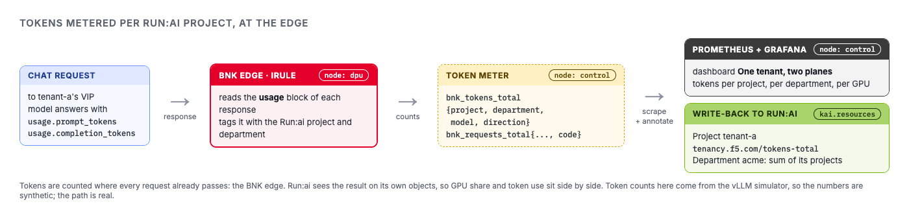

Run:ai can tell you how much GPU each project was given. It cannot tell you how many tokens each
project actually consumed, because tokens live in the request and response, not in the scheduler.
BNK sees every request, so BNK can count them.



# Step 1: Generate some tokens

```bash,run
labctl load steady --tenant tenant-a --seconds 45
labctl load steady --tenant tenant-b --seconds 30
labctl chat tenant-a "Explain GPU fractions in two sentences."
```

# Step 2: Where the count comes from

Every OpenAI-compatible model response carries a `usage` block. Look at one:

```bash,run
VIP=$(kubectl get gateway -n f5-bnk tenant-a -o jsonpath='{.status.addresses[0].value}')
MODEL=$(curl -s http://$VIP:8000/v1/models | jq -r '.data[0].id')
curl -s http://$VIP:8000/v1/chat/completions -H 'Content-Type: application/json' \
  -d "{\"model\":\"$MODEL\",\"messages\":[{\"role\":\"user\",\"content\":\"hi\"}],\"max_tokens\":16}" | jq .usage
```

At the BNK edge, the tenant's iRule reads that block on the way out and attributes it to the Run:ai
project and department that own the Gateway. The token meter turns it into Prometheus counters:

- `bnk_tokens_total{project, department, model, direction}`, where direction is prompt or completion
- `bnk_requests_total{project, department, model, code}`

```bash,run
kubectl get pods -n bnk-runai-tenancy
labctl dash
```

An honest note: the counting point is BNK, but the numbers are what the model reported. The models
here are vLLM simulators, so the token counts are synthetic. The path from response to Run:ai object
is the real one.

# Step 3: One tenant, two planes

Open the **Grafana** tab, dashboard **One tenant, two planes**. Each row is a Run:ai project:

- **GPU** plane: deserved and allocated GPU, from Run:ai
- **Request** plane: req/s and 429s, from BNK
- **Tokens per project** and the **department** rollup
- **Tokens per GPU**: tokens divided by the project's GPU share

That last panel is the question a platform team gets asked: is `tenant-a`'s 2-GPU quota earning
its keep compared with `tenant-b`'s half GPU? Before this, answering it meant joining scheduler data
with gateway logs by hand.

# Step 4: The totals are reported against Run:ai

Run:ai lets only its own services write projects, so the meter keeps the durable totals in a usage
ledger and posts them as events on each Run:ai project and department, where any Run:ai admin sees them:

```bash,run
kubectl -n bnk-runai-tenancy get cm bnk-runai-usage -o jsonpath='{.data}' | jq .
kubectl get events -A --field-selector reason=TokensMetered \
  -o custom-columns='KIND:.involvedObject.kind,NAME:.involvedObject.name,MESSAGE:.message' | tail -6
```

`project.tenant-a` and `project.tenant-b` are each project's running total. `department.default` is
their sum: the department roll-up. Compare the ledger with the meter's own counters:

```bash,run
M=$(kubectl get node control -o jsonpath='{.status.addresses[?(@.type=="InternalIP")].address}')
curl -s http://$M:9100/metrics | grep -E '^bnk_tokens_total' | grep -v 'model="none"'
```

Prompt plus completion for a project adds up to its ledger total, within one 30-second write. A
chargeback script or an admin view can read this without learning about BNK or Prometheus.

Click **Check** once tenant-a has a token total.
