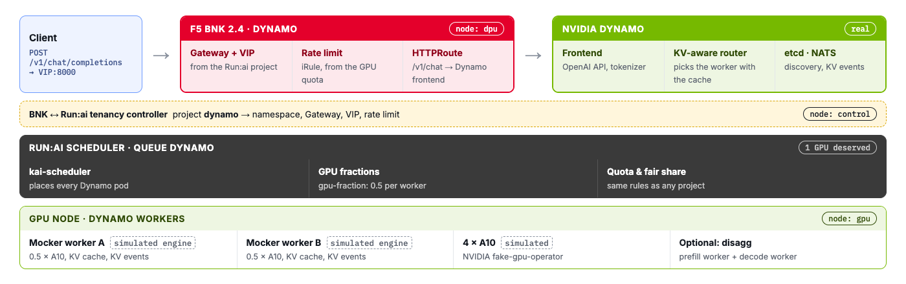

# NVIDIA Dynamo, with BNK picking the worker

NVIDIA Dynamo is a serving layer for large models. Its workers keep a KV cache of the prompts they have
seen, and they announce every block they store or evict as an event. BNK 2.4 can listen to those
events: its Endpoint Picker reads them, decides which Dynamo worker already holds a prompt, and sends
the request straight to that worker.

In this challenge Dynamo runs as one more Run:ai project. Run:ai places its workers on the GPUs. BNK
gives the project its front door, and BNK, not Dynamo's own router, picks the worker for every request.



| Real | Simulated |
|---|---|
| Dynamo operator, frontend, KV events over NATS | **Mocker**, Dynamo's own simulated engine, instead of vLLM |
| Run:ai project, queue, scheduler and GPU fractions | The GPUs (fake-gpu-operator) |
| BNK 2.4 Gateway, rate limit, metering, and the Endpoint Picker in Dynamo mode | The DPU |

> **Mocker** is part of Dynamo. It registers like a real worker, keeps a simulated KV cache, publishes
> the same KV events as a real worker and returns generated tokens. It loads the tokenizer, not weights.

---

## Step 1 · Deploy Dynamo as a Run:ai project

Dynamo runs the way NVIDIA documents it: a `DynamoGraphDeployment`, managed by NVIDIA's Dynamo
operator, which setup installed. Have a look at it in the **Lab code** tab, `dgd.yaml`.

The script creates the Run:ai project `dynamo` with 1 GPU of quota, marks its namespace as running
Dynamo, and applies the graph: one Dynamo frontend and two Mocker workers. The first run pulls the
Dynamo image, so give it a few minutes.

```bash,run
bash /root/lab/platform/dynamo/deploy.sh
```

Load the namespace and the VIP into your shell:

```bash,run
source /root/lab/platform/dynamo/env.sh
```

---

## Step 2 · See Run:ai place the workers

Every Dynamo pod asks for the Run:ai scheduler and joins the `dynamo` queue. The two workers ask for
half a GPU each:

```bash,run
kubectl -n $NS get pods -o custom-columns='POD:.metadata.name,NODE:.spec.nodeName,SCHEDULER:.spec.schedulerName,QUEUE:.metadata.labels.runai/queue,GPU:.metadata.annotations.gpu-fraction'
```

You should see four pods. The two `mocker-decode` pods are the workers, on the gpu node at `0.5` GPU
each. `mocker-frontend` is Dynamo's own frontend and router. It needs no GPU, and BNK doesn't send
traffic through it. `model-pool-epp` is BNK's Endpoint Picker for this project, on the dpu node next to
TMM. The tenancy controller created it, and you'll look at it in the next step.

Each worker pod has two containers:

```bash,run
kubectl -n $NS get pods -l nvidia.com/dynamo-component-type=decode -o custom-columns='POD:.metadata.name,CONTAINERS:.spec.containers[*].name'
```

One is the Mocker worker. The other is a small Dynamo frontend in **direct mode**. Direct mode does no
routing of its own. It serves whichever worker the request names, and refuses a request that names
none. Someone else has to pick. That someone is BNK.

---

## Step 3 · How BNK learns about Dynamo

The tenancy controller saw the namespace annotation and gave this project a different Endpoint Picker
from the other tenants:

```bash,run
kubectl get namespace $NS -o jsonpath='{.metadata.annotations}' | jq .
kubectl -n $NS get f5-epps model-pool-epp -o jsonpath='{.spec}' | jq '{engine, natsURL, metricsPort: .server.modelServerMetricsPort}'
```

`engine: dynamo` and `natsURL` are the two fields BNK 2.4 documents for Dynamo. The picker subscribes
to Dynamo's event bus, NATS, and reads the KV-cache events the workers publish.

The pool is the two worker pods, picked out by the labels Dynamo's operator put on them. Dynamo's own
frontend is not in it:

```bash,run
kubectl -n $NS get inferencepools.inference.networking.k8s.io model-pool -o jsonpath='{.spec.selector}' | jq .
```

---

## Step 4 · Send requests through BNK

```bash,run
curl -s http://$VIP:8000/v1/models | jq -r '.data[].id'
```

A chat request through the VIP. `nvext.extra_fields` asks Dynamo to report which worker served it:

```bash,run
curl -si http://$VIP:8000/v1/chat/completions -H 'Content-Type: application/json' -d "{
  \"model\": \"$MODEL\", \"max_tokens\": 16, \"nvext\": {\"extra_fields\": [\"worker_id\"]},
  \"messages\": [{\"role\": \"user\", \"content\": \"Hello from the BNK front door\"}]}" \
  | grep -iE '^HTTP|x-bnk-tenant|decode_worker_id' | sed -E 's/.*("decode_worker_id":[0-9]+).*/\1/'
```

**You should see:** `HTTP/1.1 200`, `X-BNK-Tenant: dynamo`, and the ID of the worker that answered.

That ID came from BNK. The picker chose the worker and wrote its ID into the request. The direct-mode
frontend in that pod then served exactly that worker.

---

## Step 5 · BNK routes by Dynamo's KV cache

Two long prompts that start differently, six requests each. Each prompt's start is written into the
KV cache of whichever worker serves it first, and the worker announces it on NATS:

```bash,run
A=$(printf 'Our refund policy says the following. %.0s' $(seq 1 60))
B=$(printf 'The shipping terms state this clearly. %.0s' $(seq 1 60))
for p in A B; do
  eval T=\$$p; echo "== prompt $p"
  for i in $(seq 1 6); do
    curl -s http://$VIP:8000/v1/chat/completions -H 'Content-Type: application/json' -d "{
      \"model\": \"$MODEL\", \"max_tokens\": 4, \"nvext\": {\"extra_fields\": [\"worker_id\"]},
      \"messages\": [{\"role\": \"user\", \"content\": \"$T Question $i?\"}]}" \
    | jq -r '.nvext.worker_id.decode_worker_id'
    sleep 0.3
  done | sort | uniq -c
done
```

**You should see:** each prompt stays on one worker, six times out of six. Once a worker holds a
prompt's start in its cache, BNK keeps sending that prompt there, so it is not computed twice.

The picker's own log shows it receiving Dynamo's events:

```bash,run
kubectl -n $NS logs deploy/model-pool-epp | grep 'first message received' | sed 's/.*"m"="//; s/"|.*//'
```

`dynamo kv-cache` is the cache events, `dynamo active-load` the per-worker load. Both arrive over NATS
from the Dynamo workers.

**In Grafana**, the **dynamo** row shows the same traffic as every other tenant: requests per second
from BNK and tokens counted at the edge. The vLLM panels stay empty, since Mocker isn't vLLM.

---

## Step 6 · Still a tenant like any other

Dynamo gets nothing special from BNK except the picker. The same rate limit, derived from its Run:ai
quota, and the same metering apply:

```bash,run
kubectl get f5-big-cne-irules -n f5-bnk dynamo-limit -o jsonpath='{.spec.iRule}' | grep -o 'rl_n > [0-9]*'
kubectl -n bnk-runai-tenancy get cm bnk-runai-usage -o jsonpath='{.data}' | jq 'with_entries(select(.key|test("dynamo")))'
```

**You should see:** `rl_n > 20`, the 20 req/s that one GPU of quota buys, and a token total for
`project.dynamo` in the usage ledger. Those are the requests you just sent, counted at the BNK edge.

---

## Two ways to pick a Dynamo worker

Dynamo also ships its own router, inside its frontend. Both read the same KV-cache events:

| Who picks | Where it runs | What else it does |
|---|---|---|
| **Dynamo's router** | inside the Dynamo frontend | routing only |
| **BNK's Endpoint Picker** | at the BNK edge, in front of the workers | routing, plus the tenant's front door, rate limit, isolation and metering, in one place |

Here BNK does the picking, so a request never makes an extra hop through a router pod, and every
policy for the tenant sits in one place.

> One setting worth knowing: BNK 2.4's default event subject is one level shorter than the one
> Dynamo 1.5.1 publishes on. The controller adds the documented `eppConfig` override for the
> `dynamo-wire` plugin so the picker hears the events. You can see it in the F5EPP spec.

Click **Check** to finish.
