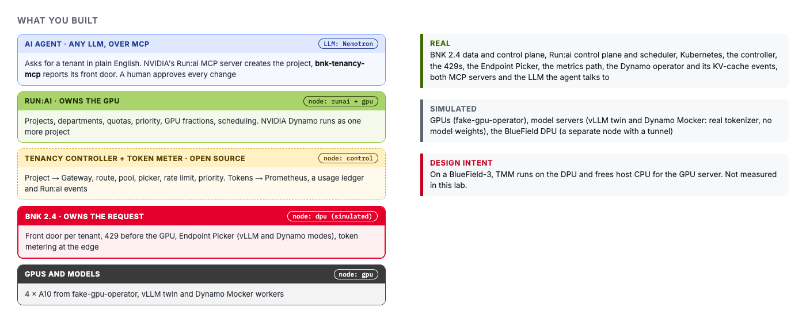

# What you built

You defined two tenants in Run:ai and never configured BNK. From each Run:ai project the controller
built a front door, a route to the tenant's model pool, an Endpoint Picker and a rate limit taken
from the GPU quota. When a project went away, so did its BNK config.

Then you saw why that matters on shared GPUs. `tenant-b` was refused at the edge with a 429 once it
went over its share, and `tenant-a`, on the same GPU, kept its latency. Tokens were counted per
project at the edge and kept in a ledger per Run:ai project and department.

Finally, NVIDIA Dynamo ran as one more Run:ai project, and BNK went a step further than a front door.
Its Endpoint Picker listened to the KV-cache events Dynamo's workers publish and sent each request to
the worker that already held its prompt.

One last look at the whole thing, from both sides.

Scroll through the **Grafana** board one more time too. Every project's GPU share, requests, 429s and
tokens are on one screen.

```bash,run
labctl status
kubectl get projects.kai.resources -o custom-columns='PROJECT:.metadata.name,DEPARTMENT:.spec.parent,NAMESPACE:.status.namespace,PHASE:.status.phase'
kubectl get gateway -n f5-bnk -o wide -L tenancy.f5.com/project
kubectl -n bnk-runai-tenancy get cm bnk-runai-usage -o jsonpath='{.data}' | jq .
```

---

## What is real, and what is simulated

| | |
|---|---|
| **Real** | BNK 2.4 (TMM and its controllers), open-source Run:ai and its scheduler, Kubernetes, the tenancy controller and token meter, the 429s, the Endpoint Picker, the metrics path, the Dynamo operator and its KV-cache events, BNK's Endpoint Picker in Dynamo mode |
| **Simulated** | the GPUs (NVIDIA fake-gpu-operator), the model servers (vLLM simulator and Dynamo Mocker, so tokens and latencies are modelled), the BlueField DPU (a node joined to the GPU node by a tunnel) |
| **Not shown** | GPU memory isolation, DPU offload, host-CPU savings |

---

## What changes with a real BlueField-3

On BlueField-3, TMM runs on the DPU itself rather than on a server core. The intent is that ingress,
rate limiting and metering stop competing with the inference server for host CPU, and refused
requests never touch the host at all. That is the design, but it isn't measured here. Figures for it
come from F5's BlueField-3 testing, not from this lab.

Nothing in the integration changes when that happens. The controller writes Kubernetes objects, and
where TMM runs is up to BNK.

---

## The open-source pieces

- **Tenancy controller and token meter**: Apache 2.0, in the **Lab code** tab under `controller/`. It
  watches `kai.resources/v1alpha1` Projects and writes standard Gateway API and BNK objects.
- **Upstream**: a docs pull request and an issue to `dsx-ai-factory/run-ai` are planned, describing
  how a service plane can consume Run:ai's tenant model. Not yet filed.

---

## Let an AI agent do it

Everything you did by hand in this lab can be asked for by an agent. The lab runs two MCP servers side
by side. One is NVIDIA's own Run:ai MCP server, which can create and manage Run:ai projects. The other
is `bnk-tenancy-mcp` from this repo, which answers what BNK built for a project: its address, its rate
limit and the tokens it has used.

The agent in `platform/mcp/agent.py` is about 250 lines of plain Python. It gives both servers' tools to
an LLM and lets the LLM decide what to call. Here the LLM is NVIDIA Nemotron on build.nvidia.com, but
any OpenAI-compatible model works the same way: change `LLM_BASE_URL`, `LLM_MODEL` and `LLM_API_KEY`.

Ask it for a tenant in plain English:

```bash,run
python3 /root/lab/platform/mcp/agent.py "Create a Run:ai project called agent-demo with 1 GPU and tell me its BNK endpoint"
```

Watch the tool calls go by. The agent looks up the node pool and the department, then asks Run:ai for
a dry run, which changes nothing. Before the real change it stops and shows you what it is about to do.
Type `y` to approve. After that it only asks BNK questions, and its answer ends with the VIP, the rate
limit of 20 req/s from the one GPU, and a token count of 0.

If the agent can't reach its LLM, the same steps run without one:

```bash,run
bash /root/lab/platform/mcp/demo.sh agent-demo 1
```

The agent never touched BNK. It asked Run:ai for a tenant, and the tenancy controller did the rest,
exactly as it did for `tenant-a` and `tenant-b`. Look at the **Run:ai UI** tab and `agent-demo` is
there next to the other projects.

The project has a front door but nothing behind it yet. Give it a model, the same way you did for
`tenant-a`, and send it one request:

```bash,run
labctl model deploy agent-demo
VIP=$(kubectl get gateway -n f5-bnk agent-demo -o jsonpath='{.spec.addresses[0].value}')
curl -s -i "http://$VIP:8000/v1/models" | grep -iE '^HTTP|x-bnk-tenant'
```

You should see `HTTP/1.1 200 OK` and `X-BNK-Tenant: agent-demo`.

In **Grafana**, `agent-demo` now shows up in the per-project panels, with its own GPU share and
request rate.

Only one of the two servers can change anything. The Run:ai server needs a Run:ai login and
shows a dry run before it creates a project. `bnk-tenancy-mcp` is read-only and holds no session, so
an agent can call it as often as it likes. The details are in `docs/mcp.md` in the **Lab code** tab.

---

Click **Check**. It passes once `agent-demo` answers through BNK.
